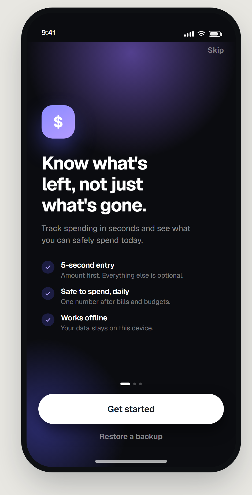
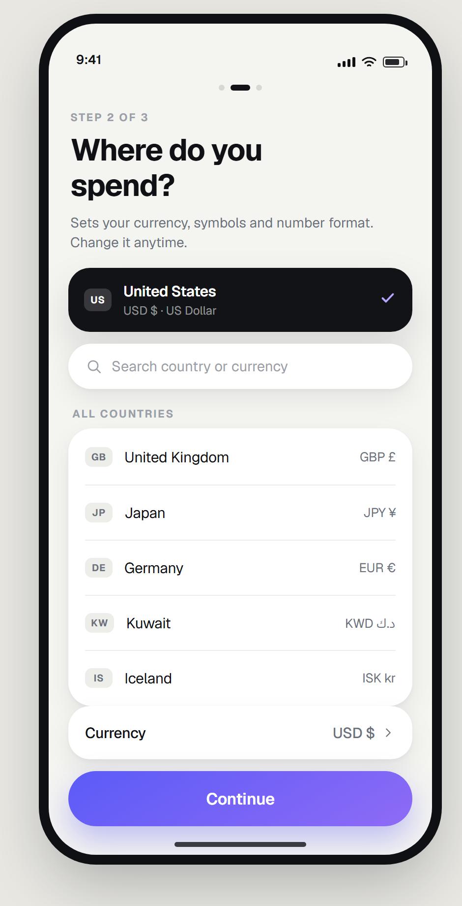
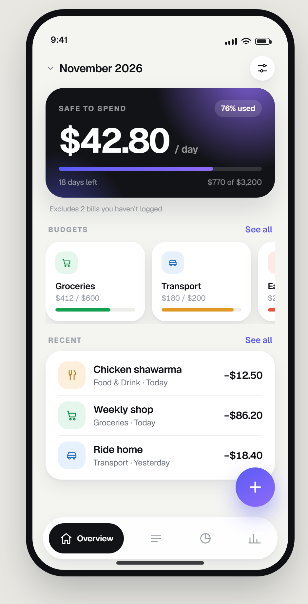
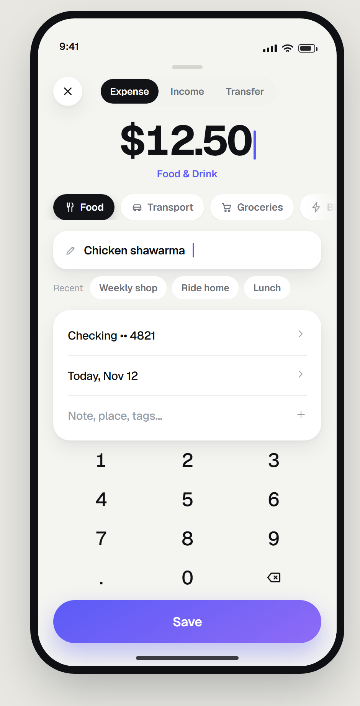
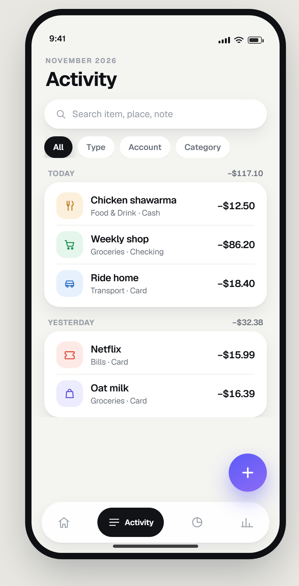
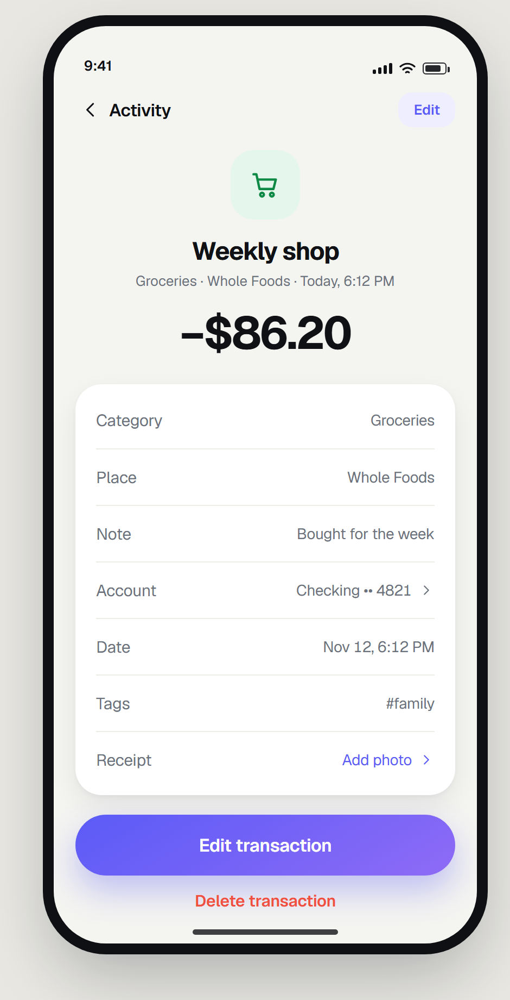
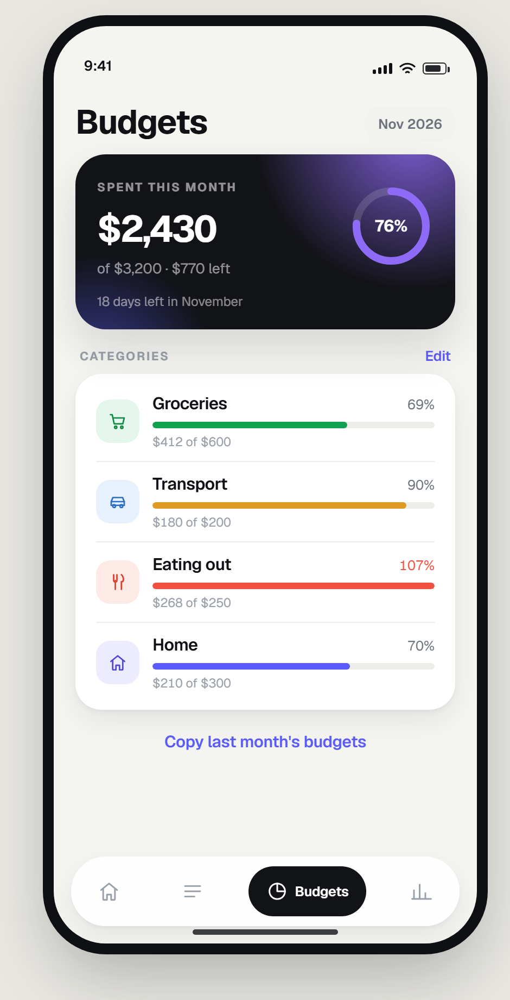
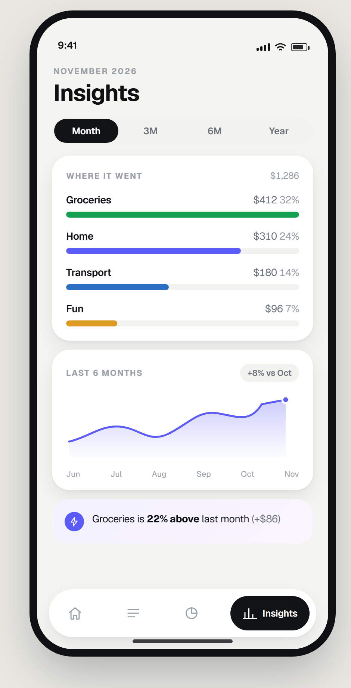
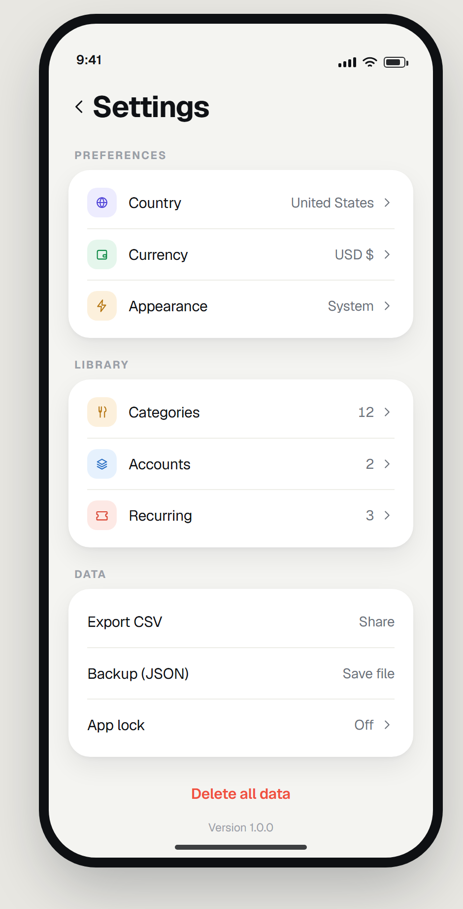

# 07 — Page Designs

Visual specification for every v1 screen. Behavior and acceptance criteria live in
`03-screens.md`; this file is about **composition, hierarchy and exact visual values**.

## Rendered mockups

Source and output live in `designs/`:

```
designs/
  build.mjs                 generates every screen from one shared stylesheet
  mockups/screens/*.html    one browsable page per screen, per theme (linked from the sheets)
  mockups/png/*.png         rendered 2× screenshots, light and dark (the artifacts docs embed)
  mockups/index.html        light contact sheet   mockups/index-dark.html  dark contact sheet
  design-board.png          light overview       design-board-dark.png   dark overview
```

Open the contact sheets directly in a browser (or through any static server) after running
`build.mjs`; the HTML is regenerated from the same tokens as the PNGs, so both always agree.

Every screen is rendered **twice** — light (`home.png`) and dark (`dark-home.png`) — except the
onboarding welcome, which is dark by design in both themes. There are two boards:
`design-board.png` and `design-board-dark.png`.

Regenerate: `node blueprints/designs/build.mjs`, then screenshot each HTML (see
`designs/README.md`). **The PNG is the reference for look; this document is the reference for
structure and measurements.** If they disagree, one of them is a bug.

**Launch rule:** the app always opens on Overview with no input mounted. The keyboard may only
appear inside the add sheet, after an explicit `+` tap — never on cold start, resume, or a
notification tap. See ADR-010.

## Global frame

- Typeface: **Geist** everywhere (`assets/fonts/Geist-Variable.ttf`), tabular figures on money.
  The mockups embed the same file the app bundles, so measurements in this document hold.
- Device frame in mockups: **390 × 844** (iPhone 14/15 logical size). Values are density-
  independent points; nothing is positioned in absolute device pixels.
- Status bar `54`, then content. Screen gutter `20`. Card padding `18`. Card gap `12`.
- Surface ladder: warm canvas `bg` → white `card` → ink `hero` (one per screen).
- Cards: radius `24`, **shadow, no border** (`0 10px 26px rgba(16,18,23,.07)` plus a 2 px
  contact shadow). Hairlines only inside groups, inset to the text.
- Ink card: radius `28`, padding `18 20`, one radial iris glow top-right plus a fainter
  bottom-left glow. Text on ink uses white at 100 / 55 / 50% for primary / secondary / tertiary.
- Section header: `eyebrow` type (11/700, +1.3 tracking, uppercase, `text3`) with an optional
  accent `See all` at 13/600. Rhythm: 16 above, 8 below.
- Floating tab bar `64` tall, `16` inset from the bottom, `32` radius, blurred white. Four
  destinations: Overview · Activity · Budgets · Insights. Active tab is an ink pill with icon
  **and** label; inactive tabs are icon-only at `text3`.
- Scrollable content ends `96` above the bottom edge so nothing hides behind the tab bar.

```
┌───────────────────────────────┐  ← 390 wide
│ 9:41                ▪▪▪ ᯤ ▮  │  status 54
│                               │
│  screen content, 20 gutter    │  flex
│                               │
│   ╭───────────────────────╮   │  floating tab 64
│   │ Overview  ·  ·  ·     │   │  inset 16
│   ╰───────────────────────╯   │
└───────────────────────────────┘
```

---

## 1. Onboarding — welcome



**Composition:** full-bleed dark screen (`#0B0C10`) with an iris radial glow behind the top third
and a second, fainter one bottom-left. This is the only dark-first screen in v1 — it exists to
make the first three seconds feel premium, not form-like.

1. `Skip` top-right, 14/600 at 45% white, 44 pt target.
2. Logo mark 62 × 62, radius 20, iris gradient, white `$`, glow `0 18px 40px` at 45% accent.
3. Headline 34/39, weight 700, tracking −1.5, three lines, white.
4. Body 15/22 at 55% white, max 280 pt.
5. Three value rows: 24 pt accent-tinted circle with a white check, title 14/600, subtitle 12.5 at
   45% white. Copy: "5-second entry", "Safe to spend, daily", "Works offline".
6. Pager dots: three, 5 px tall; active is an 18 × 5 white pill, inactive 5 × 5 at 25% white.
7. CTA: white pill, 56 tall, ink label 16.5/600. Secondary `Restore a backup` is 14/600 at 50%
   white, 46 tall.

**States:** `Skip` hidden on step 3 only if a budget was entered; CTA label `Continue` on 2–3 and
`Finish` on step 3.

---

## 1b. Onboarding — country & currency



**Composition (top → bottom):** pager dots (second active) → eyebrow `STEP 2 OF 3` → headline
"Where do you spend?" (31/36) → one-line explanation → **selected-country ink card** → search pill
→ `ALL COUNTRIES` group card → pinned footer with a `Currency` row and the CTA.

1. The selected country card is ink (the same surface as the Home hero) and shows country name,
   `USD $ · US Dollar`, and an accent check. It is the current answer, always visible above the
   fold.
2. Search pill: 46 tall, full radius, white, no border, placeholder `Search country or currency`.
   Matches country name, ISO code and currency code.
3. Country rows are 56 tall inside one 24-radius card: ISO code chip (28 × 22, radius 7, warm
   grey fill) + name 15/500 + currency `code symbol` right-aligned 13 `text2`. No chevrons — the
   row *is* the selection. Flags are rendered as the code chip in mockups and as emoji glyphs on
   device; the code is the fallback when the platform lacks flag data.
4. `Currency` sits in its own card directly above the CTA, value `USD $ ›`. It is deliberately
   separated: the country is context, the currency is money.
5. CTA `Continue` is the iris pill (accent gradient), 56 tall. Disabled until a country is
   selected; the detected default counts as selected.
6. Zero search matches: `No countries match "xyz"` + `Clear`, never a blank card.

**States:** unchanged selection, dirty (`Continue` enabled), confirming currency change, write
error (selection preserved, retry inline).

---

## 2. Overview (Home)



**Composition:** header row → ink safe-to-spend hero → one truth line → `BUDGETS` section with a
peeking horizontal card row → `RECENT` section with one grouped list card → FAB → floating tab bar.

1. Header: month selector left (`⌄ November 2026`, 17/600, chevron 15 in `text3`); settings
   button right — 38 pt white circle, soft shadow, sliders glyph. No account filter row on this
   screen; accounts are filtered in Activity.
2. Hero (ink, radius 28): eyebrow `SAFE TO SPEND`, glass `76% used` pill, hero number 52/54
   (−1.8 tracking) with `/ day` at 15/600 in 55% white, 6 px gradient progress track, foot row
   `18 days left` / `$770 of $3,200` at 11.5 in 50% white. The bar is spend vs budget, filled
   with the iris gradient.
3. Truth line under the hero: 11 pt `text3`, e.g. "Excludes 2 bills you haven't logged". It is
   outside the card so it never competes with the number.
4. Budget cards: horizontal scroll, 152 wide, radius 22, white, shadow. Icon tile 34, name
   13.5/600, `spent / limit` 11.5 `text3`, 5 px bar colored by threshold (income green /
   warning amber / danger coral). Third card peeks 24 pt past the gutter — that is the affordance.
5. Recent: **3 rows** in one card, 42 pt tinted icon tiles, item name 15.5/600, `category · day`
   12.5, amount 15.5/600 in ink.

**Empty state** (`home-empty.png`): no hero, no FAB, no budget/recents sections. A 96 pt iris
gradient tile with a wallet glyph, `Start with one` headline, one sentence, iris CTA `Log your
first expense`, the reassurance "No account needed · works offline", then a two-row setup card
(`Set a monthly budget`, `Add a recurring bill`) pinned above the tab bar.

**Do not:** add a second glow, put the FAB over the tab bar, show a spinner on reopen, or make an
expense amount red just because it is an expense.

---

## 3. Add transaction (modal)



> The mockup image still shows the retired custom keypad; the shipped amount field uses the
> native numeric keyboard.

**Composition:** grabber → header (close circle · segmented · spacer) →
amount block → category chip row → **item-name row** → recent-name chips → account/date/details
group card → iris Save pill. The OS keyboard lifts the sheet when a field is focused; no second
keypad is mounted.

1. Presented as a native modal sheet (radius 28–32 top, swipe to dismiss). Grabber is platform
   chrome. Reachable only from an explicit add action.
2. Header: close in a 38 pt white circle (44 pt target), segmented control 232 wide, track
   `surfaceMuted`, selected segment an **ink pill with white label**. Segments: Expense / Income /
   Transfer.
3. Amount block: 54/58, weight 700, tracking −2.2, tabular, editable native numeric field with a
   caret. Category name under it at 13/600 in `accent` — one source of truth, no duplicate label
   in the chip. For 0-exponent currencies the number pad has no decimal separator and input is
   sanitized to reject fractions.
4. Category chips: 34 tall, pill radius 17, icon 15 + label 13/600; unselected white with a 1 px
   contact shadow, selected **ink with white text**. Last chip is always `More…`; the row scrolls
   horizontally and fades at the right edge (never clips mid-word without a fade).
5. Name row: 50 tall, radius 18, white, shadow; pencil 16 in `text3`, placeholder `What was it?`,
   typed value 15/600 ink. Optional.
6. Recent-name chips: 30 tall, white, no shadow, 12.5/600 `text2`, preceded by a 12 pt `Recent`
   label. Up to 5; hidden once the user types.
7. Account / date / details: one white 22-radius card, three 52 pt rows with inset hairlines;
   account and date show a chevron, the details row shows `Note, place, tags…` in `text3` with a
   `+`. Expanded, it becomes place + note inputs and tag chips.
8. Save: full-width iris pill 56 tall, glow `0 12px 26px` at 34% accent; disabled state is
   `surfaceSunken` with `text3` label; saving shows a 20 pt spinner and locks input.

**Keyboard open** — the sheet lifts above the OS keyboard, its body scrolls, and the header plus
Save stay pinned. The amount and item name share the same OS keyboard; no secondary keypad is
mounted and the layout never collapses. The header X dismisses the keyboard before closing.

**Transfer mode:** category chips and the name row are replaced by a `To account` row; the account
row becomes `From account`; both pickers list only accounts in the active currency.

---

## 4. Activity (Transactions)



**Composition:** eyebrow `NOVEMBER 2026` + title `Activity` (31/700) → search pill → filter chips
→ day sections, each a header row plus one grouped card of rows → FAB → floating tab bar.

1. Search: 46 tall, full radius, white, shadow, 18 pt magnifier, placeholder `Search item, place,
   note`. Clear button appears only when non-empty.
2. Filter chips: 34 tall pills; `All` selected is **ink**, the rest white. Active filters show the
   value (`Type · 2`) in `accent` with an `accentSoft` fill. The last chip opens the full filter
   sheet.
3. Day header: `eyebrow` date label left, day total right at 12.5/600 `text2` (not expense-red).
   Seventeen pt above, six below.
4. Day card: radius 24, white, shadow, 16 px horizontal padding. Rows 9 px vertical padding,
   hairline between rows. Leading 42 pt tinted icon tile; title 15.5/600; subtitle
   `category · account`, plus a 12 pt note glyph when a note exists; amount 15.5/600 ink.
5. Swipe: right → edit (accent block), left → delete (coral block), 72 pt action width, undo
   snackbar.
6. Empty (no data): icon, `No transactions yet`, one sentence, `Add transaction` iris CTA.
   No results: `No matches` + `Clear filters`; filters are never auto-reset.

---

## 5. Transaction detail



**Composition:** back + contextual title with a right-side `Edit` accent pill → centered hero →
grouped detail card → iris `Edit transaction` → coral text `Delete transaction`.

1. Nav: `‹ Activity` (16/600) left, `Edit` in an `accentSoft` pill (32 tall) right — both 44 pt
   targets.
2. Hero: 64 pt tinted icon tile (radius 22, category color), item name 23/700 (−0.6), metadata
   `category · place · relative date` 13 `text2`, amount 42/700, tracking −1.5, **ink** (sign carries
   direction; income is green). Place is omitted when empty.
3. Detail card: 22-radius card, 52 pt rows, label `text2` 15, value 15/600 right-aligned with
   chevron only when it is actionable (Account, Receipt). Empty optional rows are hidden. A
   `Currency` row appears only when the row's currency differs from the active one.
4. Actions: iris pill (56) then a 46 pt coral text button. Delete never sits beside Save-like
   buttons and always confirms through undo.
5. Transfers show From and To accounts and no category row.

---

## 6. Budgets



**Composition:** title row with a `Nov 2026` soft pill → ink overall card with a **progress ring**
→ `CATEGORIES` card → ghost `Copy last month's budgets`.

1. Title `Budgets` 31/700; month pill 32 tall, `surfaceMuted`, 12.5/600, opens the period picker.
2. Overall card (ink): eyebrow `SPENT THIS MONTH`, total 34/700 (−1.3), `of $3,200 · $770 left`
   at 13 in 55% white, and a 78 pt ring on the right — 7 px stroke, track at 14% white, progress in
   `accentAlt`, percentage centered at 15/700. Foot line `18 days left in November` at 12 in 50%
   white.
3. Category rows (10 px vertical padding): 40 pt tinted icon tile, name 15.5/600, percentage 12.5
   right-aligned (`danger` at ≥100%), 6 px bar in the category/threshold color, `$412 of $600`
   11.5 `text3` beneath. Rows without a budget show `Set limit` in accent with a dashed track.
4. The card is one surface — rows are separated by hairlines, not individual cards.
5. Ghost action 46 tall in accent; enabled only when last month has budgets.

Thresholds: primary (or category color) < 80%, `warning` 80–99%, `danger` ≥ 100% with a full bar.

---

## 7. Insights



**Composition:** eyebrow + title → segmented pill → breakdown card → trend card → insight card.

1. Segmented control 36 tall, full radius, `surfaceMuted` track, ink selected thumb, 4 equal
   segments (Month / 3M / 6M / Year).
2. Breakdown card: eyebrow `WHERE IT WENT` with the period total right-aligned. Each category is
   label 13.5/600 + amount + percent (`text3`), then an **8 px rounded bar** at 100% of the
   category color on a `surfaceMuted` track. Max 6 categories, remainder collapsed into `Other`.
   No pie charts.
3. Trend card: eyebrow `LAST 6 MONTHS` with a delta pill (`+8% vs Oct`). A smooth SVG area chart,
   2.6 px iris line, iris gradient fill fading to transparent, a 4.5 px endpoint dot ringed in
   white, month labels 10.5 `text3`. No grid, no axes.
4. Insight card: `accentSoft`→white gradient, 22 radius, 26 pt iris circle with a bolt, one
   sentence at 13.5/19, bold only on the number. Max 2 cards.
5. With < 2 months of data the trend card is replaced by a note ("Trend unlocks next month") and
   the breakdown keeps full width.

---

## 8. Settings



**Composition:** back + `Settings` title → grouped cards with a leading tinted icon per row →
coral `Delete all data` text button → version line.

1. Groups (`PREFERENCES`, `LIBRARY`, `DATA`) use the `eyebrow` style at 20 pt above, 8 below.
2. Each group is one 22-radius white card. Rows are 52 tall with a **30 pt tinted icon tile**, label
   15/500, value 14 `text2` + 15 pt chevron. Hairlines inset to the label.
3. `Country` and `Currency` both open the same **Currency & region** screen (§1b), with a back
   chevron instead of pager dots. Currency shows `USD $`, never a flag alone.
4. Data rows: `Export CSV` (Share), `Backup (JSON)` (Save file), `App lock` (Off ›).
5. `Delete all data` is a 46 pt coral text button, separated from the cards, typed confirmation
   (`DELETE`) only.
6. Version sits as a quiet 11.5 `text3` line, not a row — it is not a destination.

---

## Dark mode composition

Dark mode is not a tint of light mode — see `design-board-dark.png`. Rules that change the look:

1. **Surfaces step up from black**: canvas `#0B0C10` → card `#15171C` → subtle `#1C1F25`. Cards
   also get a 1 px white-at-5.5% outline, because shadows are invisible on black.
2. **The hero stays ink** (`#1A1C22`) with the same iris glow, slightly stronger; it must not
   become a white block or it will fight the accent.
3. **Solid controls invert** — active chip, selected segment and the active tab pill become
   white with ink text. Accent is reserved for links, the FAB and selection on dark surfaces.
4. **Tone tiles deepen, glyphs brighten** (mint tile `#122A1D` with `#57D392` glyph, etc.). Never
   put a 10% tint over black; it turns to mud.
5. **Amounts stay ink-white**, income green, overspend coral — same semantics as light mode.
6. The tab bar becomes `rgba(21,23,28,.92)` with a hairline; blur still applies behind it.
7. Screens that sit on the canvas (onboarding) keep their fixed dark treatment in both themes.

## Component measurements (single source)

| Component | Height | Radius | Padding | Text |
| --- | --- | --- | --- | --- |
| Primary (iris) button | 56 | 28 | 0 22 | 16.5/600 |
| Secondary / ghost | 46 | 23 | 0 16 | 15/600 |
| Text input | 46 | 23 | 0 16 | 14.5/400 |
| Item-name row | 50 | 18 | 0 14 | 15/400 placeholder · 15/600 value |
| Chip | 34 | 17 | 0 14 | 13/600 |
| Small chip (recent) | 30 | 15 | 0 12 | 12.5/600 |
| List row | 60 | — | 9 0 | 15.5/600 + 12.5/400 |
| Budget row | 62 | — | 10 0 | 15.5/600 + 12.5 + 11.5 |
| Group card | auto | 24 | 0 16 | per content |
| Ink hero | auto | 28 | 18 20 | — |
| Picker row | 56 | — | 0 16 | 15/500 + 13/400 right |
| Segmented control | 38 | 19 | 3 | 12.5/600 |
| Floating tab bar | 64 | 32 | 0 8 | 12.5/600 active only |
| FAB | 60 | 30 | — | 25/2.4 glyph |

## Design review checklist (per screen)

- [ ] One ink surface maximum; its glow is the only glow on the screen.
- [ ] Headline number is unambiguous within one second and uses tabular figures.
- [ ] Expense amounts are ink, income is green, coral only signals overspend/error/destruction.
- [ ] Every number is tabular and carries a currency symbol or code.
- [ ] Rows show the item name (or place), never just the category, when a name exists.
- [ ] Amounts survive the widest currency string tested (`CHF 1,234.50`, `KWD 1.250`, `¥12,400`)
      at 200% text scale without clipping or shifting the row.
- [ ] Content clears the floating tab bar by 96 pt; nothing scrolls under the active pill
      unreadably.
- [ ] Three states designed: populated, empty, error.
- [ ] Dark mode tokens only — zero literal hex in feature code.
- [ ] All interactive targets ≥ 44 pt; destructive paths separated and confirmed.
