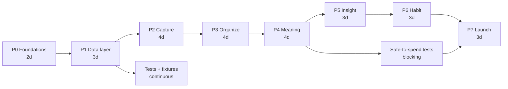
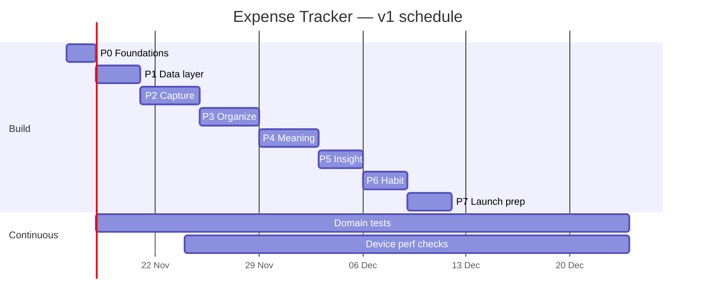

# 08 — Phases of Work

Detailed execution plan. `05-roadmap.md` says *what* ships when; this document says *which work
happens in which phase, in what order, what blocks what, and how a phase is proven done*.

## Phase map

| Phase | Name | Duration | Output that can be demoed | Gate |
| --- | --- | --- | --- | --- |
| P0 | Foundations | 2 days | App boots into an empty themed shell, DB created | `tsc`, `lint`, `expo-doctor` clean; DB file exists |
| P1 | Data layer | 3 days | Seeded DB, passing domain tests | Tests green; migration re-run safe |
| P2 | Capture | 4 days | Log/edit/delete a transaction end to end | 5-second entry stopwatch met |
| P3 | Organize | 4 days | Accounts, categories, history search/filter | 5k rows scroll smoothly |
| P4 | Meaning | 4 days | Safe-to-spend home + budgets | Home number matches breakdown sheet |
| P5 | Insight | 3 days | Charts, trends, insight cards | Aggregates < 50 ms on 16k rows |
| P6 | Habit | 3 days | Recurring posting, reminders, export/backup | Recurring posts exactly once |
| P7 | Launch prep | 3 days | Store-ready builds | Release checklist in `06` complete |

Total ≈ 26 working days (5–6 weeks for one developer, ~3 weeks for two working P2–P5 in pairs).
Durations exclude the 20 % polish budget, which is inside each phase, not added at the end.

## Dependency graph

Critical path: `P0 → P1 → P2 → P3 → P4 → P5 → P6 → P7`. Nothing on the critical path can be
started early without its inputs; everything else can.

## Parallel tracks (two developers)

| Track A (data & logic) | Track B (UI & motion) |
| --- | --- |
| P1 repositories, migrations, domain functions | P0 theme, component kit, mockup-to-code parity |
| P2 save/validation logic, idempotency | P2 keypad, chips, modal transitions |
| P3 query builders, filters, indexes | P3 list virtualization, swipe actions, search states |
| P4 period math, safe-to-spend | P4 hero card, budget sheet, progress states |
| P5 SQL aggregates | P5 SVG charts, insight cards |
| P6 recurring scheduler, export serializers | P6 settings screens, snackbars, empty states |

Contract between tracks: repositories and domain functions are written first with types and
fake data; UI builds against them. Never let UI invent field names.

---

## P0 — Foundations (2 days)

Goal: a runnable shell with the design system wired in, before any feature exists.

Tasks:
- [x] `npx expo install expo-sqlite expo-localization expo-haptics expo-notifications
      react-native-svg expo-local-authentication expo-file-system expo-sharing expo-image-picker
      expo-crypto`
- [x] Commit `src/constants/currencies.ts` (ISO 4217 + exponent + symbol) and
      `countries.ts` (ISO 3166-1 + default currency), plus starter categories.
- [x] `lib/format/money.ts`: `Intl.NumberFormat` path **and** the static-table fallback, both
      returning identical strings for USD/EUR/JPY/KWD.
- [ ] Confirm dev builds on one iOS and one Android device/emulator. *(not run — needs hardware)*
- [x] `src/lib/theme/tokens.ts` + `ThemeProvider` + `useTheme` (light/dark, system default).
- [x] Root `_layout.tsx`: providers, splash hold, DB init, error boundary, theme.
- [x] `expo-font` loads `assets/fonts/Geist-Variable.ttf`; splash hides only after the font is
      ready; verify `tnum` alignment on a column of amounts on iOS and Android. *(tnum proven in
      the renderer; on-device weight rendering still needs the dev build above)*
- [x] Component kit skeletons: `Money`, `Card`, `Button`, `ListRow`, `ProgressBar`, `Sheet`,
      `TextField`, `FieldRow`, `PickerSheet`, `EmptyState`, `SectionHeader` (visual only, no data).
- [x] Navigation shell: `(tabs)/_layout.tsx` + `FloatingTabBar` for Overview · Activity ·
      Budgets · Insights, with placeholder screens and no feature logic. The P0 kit demo screen
      was deleted once P1 landed: `/` is Overview and no dev screen is linked from the UI.
- [x] Lint/format config, `tsc --noEmit` green, path aliases verified.
- [ ] Freeze the dependency set (lockfile committed). *(lockfile updated, not committed)*

Files: `src/lib/theme/*`, `src/components/*`, `src/constants/*`, `src/lib/format/*`,
`src/lib/db/client.ts`, `src/app/_layout.tsx`, `src/app/(tabs)/*`, `app.json`.
Demo: app launches to a token-driven placeholder screen in both themes.
Gate: `npx tsc --noEmit`, `npx expo lint`, `npx expo-doctor` clean on a fresh clone.
Risk: adding native modules forces dev builds — do it on day 1, not day 20.

Status at implementation time: typecheck, lint and doctor (20/20) pass; currency and country
reference data were validated against Intl (153 currencies, 189 countries) including the
USD/EUR/JPY/KWD formatter matrix. Two things stay open on purpose: the device builds (no hardware
in the working environment) and an `expo-linear-gradient` accent button — the button is solid
iris until the FAB lands, because P0 may not add a dependency outside the approved list. The
same rule applies to the tab bar: it uses the translucent `tabBar` token, not a real backdrop
blur, until `expo-blur` earns a place in the dependency set. The schema gap P0 left open has
since been closed by P1: `client.ts` now migrates and seeds on boot, and the schema is at v1.

## P1 — Data layer (3 days)

Goal: the schema is real, seeded, migrated, and queryable — with pure logic tested.

Tasks:
- [x] `src/lib/db/client.ts`: open DB, `PRAGMA journal_mode=WAL`, `foreign_keys=ON`.
- [x] Migration 001 (full schema from `02-data-model.md`), `user_version` runner.
- [x] Seed starter categories + one default account (idempotent).
- [x] Repositories: `accounts`, `categories`, `transactions`, `budgets`, `recurring`,
      `settings` (only SQL lives here). Transactions take/return `itemName`, `place`, `note`,
      `amountMinor`, `currency`.
- [x] `src/lib/domain/`: `dates.ts` (local date, period ranges), `budgets.ts`, `safeToSpend.ts`,
      `region.ts`. Money parsing/formatting stays in `src/lib/format/money.ts` — it was already
      pure and imported by the UI, so a second `domain/money.ts` was not created.
- [x] Settings resolution: device country/currency from `expo-localization`, persisted on first
      open; seed the default account in that currency.
- [x] Jest + `jest-expo` configured; tests for money parsing (0/2/3-decimal currencies, excess
      decimals rejected), period boundaries, DST day, leap year, month-end clamping, overspend
      clamp, mixed-currency exclusion.
- [x] Fixture seeder: 12 months / ~2,000 transactions for perf work.

Demo: log rows via a debug screen, restart, data persists. `/dev-data` seeds fixtures, re-runs
migrations and deletes transactions; it is reached from a `__DEV__`-only card on Overview, so a
release build ships no dev entry point at all.
Gate: all unit tests pass; running migrations twice is a no-op; deleting the DB file restores
a clean seeded state.

Status at implementation time: 47 tests pass across 6 suites, `tsc` and `expo lint` clean. The
migration, seeding, repositories and fixture seeder run against a real SQLite engine (Node's
`node:sqlite`) through a narrow `Db` adapter rather than against `expo-sqlite`, because Jest has
no native module. That covers: ten tables after a fresh migrate, a second migrate applying
nothing, seeds not duplicating, the transfer CHECK and account foreign key rejecting bad rows,
totals excluding the other currency, one overall budget per period/currency via the partial
index, and balances including income, expenses and transfers. Still unverified: deleting the DB
file on a device and surviving a real restart — both need the dev build.

## P2 — Capture (4 days)

Goal: the wedge works, single-handed, offline, in under five seconds from `+` — and the app
never opens into an input.

Tasks:
- [ ] Add-transaction modal with type segmented control, amount keypad, category chips,
      **item-name row** (optional, recent-name chips, keyboard-mode layout per ADR-014),
      account/date pickers, optional place/note/tags behind the details row.
- [ ] Onboarding: welcome + **country & currency step** (`settings/region.tsx` shared with
      Settings) so the first transaction is entered in the right money.
- [ ] Launch behavior: Home only — no add sheet, keypad, or OS keyboard on start, resume, or
      notification tap (ADR-010).
- [ ] Validation and idempotency guard (double-tap safe), optimistic insert + undo.
- [ ] Category suggestion from `category_rules` and recent history.
- [ ] Transaction detail + edit reusing the same form component.
- [ ] Haptics wrapper and success feedback.
- [ ] Empty home state with "Log your first expense" CTA.

Demo: stopwatch from tapping `+` to saved entry, once without a name and once with one (app
launch timed separately); airplane mode on; kill app and verify persistence.
Gate: five timed attempts of price+category, median ≤ 5 s; five with item name, median ≤ 8 s;
launching the app 10× never presents a keyboard or the add sheet; the OS keyboard never covers
the amount or Save; no duplicate rows on rapid taps; undo restores exactly.
Risk: keypad/keyboard mode switching jank on low-end Android — test on the slowest device
available, including a hardware-keyboard case where the OS keyboard never appears.

## P3 — Organize (4 days)

Goal: anything logged can be found, fixed, and structured.

Tasks:
- [ ] Transactions list grouped by day with sticky headers and day totals.
- [ ] Search (debounced) over item name, place, note, category and amount; filter sheet
      (date/type/account/category/currency/note), active filter badges.
- [ ] Swipe actions: edit right, delete left, undo snackbar.
- [ ] Accounts CRUD with computed balances; transfers.
- [ ] Categories CRUD: reorder, rename, recolor, archive, one level of nesting.
- [ ] List performance: fixed row heights, memoized rows, `keyExtractor`.

Demo: 5,000-row fixture — search, filter, edit, delete, undo, transfer, archive a category.
Gate: steady 60 fps scroll on mid-range Android; archived category disappears from pickers but
history keeps rendering; no orphaned rows (`foreign_key_check` clean).

## P4 — Meaning (4 days)

Goal: budgets exist and the home screen answers "can I spend today?".

Tasks:
- [ ] Period math: weekly/monthly/yearly with anchor, month-end clamping.
- [ ] Budget CRUD (per category + overall) with `currency` snapshots, threshold states,
      copy-last-month, "recreate in <new currency>" for old-currency budgets.
- [ ] Onboarding step 3: first-budget field in the chosen currency (skippable), wired into the
      same finish-write transaction as steps 1–2.
- [ ] `safeToSpend` query + breakdown sheet with the plain-language formula.
- [ ] Home composition: month selector, hero, budget rows, recent rows, FAB.
- [ ] Unit tests for safe-to-spend including committed bills and zero budgets.
- [ ] Calculation transparency: "excludes N bills you haven't logged".

Demo: set budgets, log expenses (named and unnamed), watch safe-to-spend fall; open breakdown
and reconcile by hand; switch currency and confirm old totals are excluded, not converted.
Gate: hero and sheet agree to the cent; changing a budget updates Home without reload; the
formula is documented in code and tests.

## P5 — Insight (3 days)

Goal: the past is legible without reading a spreadsheet.

Tasks:
- [ ] SQL aggregates (all filtered by active currency): category breakdown, monthly trend, top
      items, month-over-month deltas.
- [ ] `BreakdownBars`, `TrendChart` SVG components with accessible text summaries.
- [ ] Insight card generation (deterministic thresholds, not AI).
- [ ] Period segmented control; drill-through to filtered transactions.
- [ ] Empty/insufficient-data states.

Demo: switch periods, tap a category, land on the matching filtered list.
Gate: 16k-row fixture aggregates < 50 ms; charts have text equivalents; no pie charts.

## P6 — Habit (3 days)

Goal: the app maintains itself and cannot lose data.

Tasks:
- [ ] Recurring rules UI; foreground posting with idempotency; missed-occurrence backfill.
- [ ] Local notifications for reminders (permission flow + in-app fallback card).
- [ ] CSV export, JSON backup, JSON restore with validation and preview, reset-all.
- [ ] App lock (biometrics) behind a setting.
- [ ] Settings screens complete: **Currency & region** (change flow with the no-conversion
      confirmation), appearance, about, privacy.

Demo: a 3-month-old rule posts every missed occurrence exactly once; export opens in a
spreadsheet; restore on a second device reproduces identical totals.
Gate: `recurring_id + local_date` uniqueness proven by test; export/import round-trip equality;
biometric lock does not trap the user after a failed scan (PIN/passcode fallback).

## P7 — Launch prep (3 days)

Goal: shippable, store-ready, documented.

Tasks:
- [ ] Name, icon, splash, screenshots, listing copy, privacy policy (local-only claim).
- [ ] Accessibility pass (VoiceOver/TalkBack end-to-end add flow, incl. naming an item),
      reduce-motion.
- [ ] Currency matrix check: USD (2 decimals), JPY (0, no `.` key), KWD (3), CHF symbol width.
- [ ] Dark mode and 200 % text-scale sweep on both platforms.
- [ ] EAS `production` build + internal track; crash reporting decision; `eas.json`.
- [ ] Release checklist from `06-decisions-and-risks.md` executed.
- [ ] Blueprint/code parity review; ADRs updated.

Gate: clean-device run of install → onboarding → add → budget → export; Expo Doctor clean; no
console errors; store assets approved.

---

## Schedule (single developer, starting Mon 16 Nov 2026)

Buffer: one week beyond P7 for store review, device matrix bugs, and the inevitable schema
question discovered by a real user.

## What each phase must not do

| Phase | Forbidden (defer) |
| --- | --- |
| P0 | Any feature screen, any dependency not on the approved list |
| P1 | Business logic in components, SQL outside repositories |
| P2 | OCR, natural-language parsing, receipt upload, item-name autocomplete beyond recents |
| P3 | Bulk edit, multi-select, advanced query builder |
| P4 | Forecasts, projected income, debt payoff, rollover UI, FX conversion |
| P5 | AI-written insights, shareable report images |
| P6 | Cloud sync, household sharing, bank connections |
| P7 | New features of any kind |

## Phase verification ritual (do at every gate)

1. `npx tsc --noEmit` — zero errors.
2. `npx expo lint` — zero errors, no new warnings.
3. `npx expo-doctor` — clean.
4. Domain tests — all green (from P1 onward).
5. Device demo script — executed on iOS **and** Android, airplane mode on for the core flow.
6. Blueprint diff — any behavior change reflected in `02`, `03`, `07` before the phase closes.
