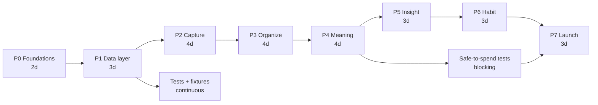
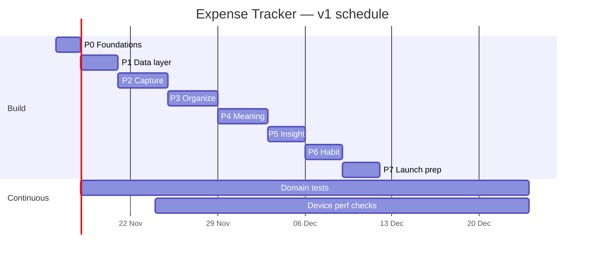

# 08 — Phases of Work

Detailed execution plan. `05-roadmap.md` says *what* ships when; this document says *which work
happens in which phase, in what order, what blocks what, and how a phase is proven done*.

## Phase map

| Phase | Name | Duration | Output that can be demoed | Gate |
| --- | --- | --- | --- | --- |
| P0 | Foundations | 2 days | App boots into an empty themed shell, DB created | `tsc`, `lint`, `expo-doctor` clean; DB file exists |
| P1 | Data layer | 3 days | Seeded DB, passing domain tests | Tests green; migration re-run safe |
| P2 | Capture | 4 days | Log/edit/delete a transaction end to end | 5-second entry stopwatch met |
| P3 | Organize | 4 days | Accounts, categories, history search/filter | 5k rows scroll smoothly |
| P4 | Meaning | 4 days | Safe-to-spend home + budgets | Home number matches breakdown sheet |
| P5 | Insight | 3 days | Charts, trends, insight cards | Aggregates < 50 ms on 16k rows |
| P6 | Habit | 3 days | Recurring posting, reminders, export/backup | Recurring posts exactly once |
| P7 | Launch prep | 3 days | Store-ready builds | Release checklist in `06` complete |

Total ≈ 26 working days (5–6 weeks for one developer, ~3 weeks for two working P2–P5 in pairs).
Durations exclude the 20 % polish budget, which is inside each phase, not added at the end.

## Dependency graph

Critical path: `P0 → P1 → P2 → P3 → P4 → P5 → P6 → P7`. Nothing on the critical path can be
started early without its inputs; everything else can.

## Parallel tracks (two developers)

| Track A (data & logic) | Track B (UI & motion) |
| --- | --- |
| P1 repositories, migrations, domain functions | P0 theme, component kit, mockup-to-code parity |
| P2 save/validation logic, idempotency | P2 amount field, chips, modal transitions |
| P3 query builders, filters, indexes | P3 list virtualization, swipe actions, search states |
| P4 period math, safe-to-spend | P4 hero card, budget sheet, progress states |
| P5 SQL aggregates | P5 SVG charts, insight cards |
| P6 recurring scheduler, export serializers | P6 settings screens, snackbars, empty states |

Contract between tracks: repositories and domain functions are written first with types and
fake data; UI builds against them. Never let UI invent field names.

---

## P0 — Foundations (2 days)

Goal: a runnable shell with the design system wired in, before any feature exists.

Tasks:
- [x] `npx expo install expo-sqlite expo-localization expo-haptics expo-notifications
      react-native-svg expo-local-authentication expo-file-system expo-sharing expo-image-picker
      expo-crypto`
- [x] Commit `src/constants/currencies.ts` (ISO 4217 + exponent + symbol) and
      `countries.ts` (ISO 3166-1 + default currency), plus starter categories.
- [x] `lib/format/money.ts`: `Intl.NumberFormat` path **and** the static-table fallback, both
      returning identical strings for USD/EUR/JPY/KWD.
- [ ] Confirm dev builds on one iOS and one Android device/emulator. *(not run — needs hardware)*
- [x] `src/lib/theme/tokens.ts` + `ThemeProvider` + `useTheme` (light/dark, system default).
- [x] Root `_layout.tsx`: providers, splash hold, DB init, error boundary, theme.
- [x] `expo-font` loads `assets/fonts/Geist-Variable.ttf`; splash hides only after the font is
      ready; verify `tnum` alignment on a column of amounts on iOS and Android. *(tnum proven in
      the renderer; on-device weight rendering still needs the dev build above)*
- [x] Component kit skeletons: `Money`, `Card`, `Button`, `ListRow`, `ProgressBar`, `Sheet`,
      `TextField`, `FieldRow`, `PickerSheet`, `EmptyState`, `SectionHeader` (visual only, no data).
- [x] Navigation shell: `(tabs)/_layout.tsx` + `FloatingTabBar` for Overview · Activity ·
      Budgets · Insights, with placeholder screens and no feature logic. The P0 kit demo screen
      was deleted once P1 landed: `/` is Overview and no dev screen is linked from the UI.
- [x] Lint/format config, `tsc --noEmit` green, path aliases verified.
- [ ] Freeze the dependency set (lockfile committed). *(lockfile updated, not committed)*

Files: `src/lib/theme/*`, `src/components/*`, `src/constants/*`, `src/lib/format/*`,
`src/lib/db/client.ts`, `src/app/_layout.tsx`, `src/app/(tabs)/*`, `app.json`.
Demo: app launches to a token-driven placeholder screen in both themes.
Gate: `npx tsc --noEmit`, `npx expo lint`, `npx expo-doctor` clean on a fresh clone.
Risk: adding native modules forces dev builds — do it on day 1, not day 20.

Status at implementation time: typecheck, lint and doctor (20/20) pass; currency and country
reference data were validated against Intl (153 currencies, 189 countries) including the
USD/EUR/JPY/KWD formatter matrix. Two things stay open on purpose: the device builds (no hardware
in the working environment) and an `expo-linear-gradient` accent button — the button is solid
iris until the FAB lands, because P0 may not add a dependency outside the approved list. The
same rule applies to the tab bar: it uses the translucent `tabBar` token, not a real backdrop
blur, until `expo-blur` earns a place in the dependency set. The schema gap P0 left open has
since been closed by P1: `client.ts` now migrates and seeds on boot, and the schema is at v1.

## P1 — Data layer (3 days)

Goal: the schema is real, seeded, migrated, and queryable — with pure logic tested.

Tasks:
- [x] `src/lib/db/client.ts`: open DB, `PRAGMA journal_mode=WAL`, `foreign_keys=ON`.
- [x] Migration 001 (full schema from `02-data-model.md`), `user_version` runner.
- [x] Seed starter categories + one default account (idempotent).
- [x] Repositories: `accounts`, `categories`, `transactions`, `budgets`, `recurring`,
      `settings` (only SQL lives here). Transactions take/return `itemName`, `place`, `note`,
      `amountMinor`, `currency`.
- [x] `src/lib/domain/`: `dates.ts` (local date, period ranges), `budgets.ts`, `safeToSpend.ts`,
      `region.ts`. Money parsing/formatting stays in `src/lib/format/money.ts` — it was already
      pure and imported by the UI, so a second `domain/money.ts` was not created.
- [x] Settings resolution: device country/currency from `expo-localization`, persisted on first
      open; seed the default account in that currency.
- [x] Jest + `jest-expo` configured; tests for money parsing (0/2/3-decimal currencies, excess
      decimals rejected), period boundaries, DST day, leap year, month-end clamping, overspend
      clamp, mixed-currency exclusion.
- [x] Fixture seeder: 12 months / ~2,000 transactions for perf work.

Demo: log rows via a debug screen, restart, data persists. `/dev-data` seeds fixtures, re-runs
migrations and deletes transactions; it is reached from a `__DEV__`-only card on Overview, so a
release build ships no dev entry point at all.
Gate: all unit tests pass; running migrations twice is a no-op; deleting the DB file restores
a clean seeded state.

Status at implementation time: 47 tests pass across 6 suites, `tsc` and `expo lint` clean. The
migration, seeding, repositories and fixture seeder run against a real SQLite engine (Node's
`node:sqlite`) through a narrow `Db` adapter rather than against `expo-sqlite`, because Jest has
no native module. That covers: ten tables after a fresh migrate, a second migrate applying
nothing, seeds not duplicating, the transfer CHECK and account foreign key rejecting bad rows,
totals excluding the other currency, one overall budget per period/currency via the partial
index, and balances including income, expenses and transfers. Still unverified: deleting the DB
file on a device and surviving a real restart — both need the dev build.

## P2 — Capture (4 days)

Goal: the wedge works, single-handed, offline, in under five seconds from `+` — and the app
never opens into an input.

Tasks:
- [x] Add-transaction modal with type segmented control, native numeric amount field, category
      chips, **item-name row** (optional, recent-name chips, stable keyboard layout per ADR-014),
      account/date pickers, optional place/note behind the details row. Tags and receipts stay
      storable but have no UI until 1.1, per 03 §3.
- [x] Onboarding: welcome + **country & currency step** (`settings/region.tsx` shared with
      Settings) so the first transaction is entered in the right money.
- [x] Launch behavior: Home only — no add sheet or OS keyboard on start, resume, or
      notification tap (ADR-010).
- [x] Validation and idempotency guard (double-tap safe), optimistic insert + undo.
- [x] Category suggestion from `category_rules` and recent history.
- [x] Transaction detail + edit reusing the same form component.
- [x] Haptics wrapper and success feedback.
- [x] Empty home state with "Log your first expense" CTA.

Demo: stopwatch from tapping `+` to saved entry, once without a name and once with one (app
launch timed separately); airplane mode on; kill app and verify persistence.
Gate: five timed attempts of price+category, median ≤ 5 s; five with item name, median ≤ 8 s;
launching the app 10× never presents a keyboard or the add sheet; the OS keyboard never covers
the amount or Save; no duplicate rows on rapid taps; undo restores exactly.
Risk: keyboard geometry on low-end Android — test on the slowest device available, including a
hardware-keyboard case where the OS keyboard never appears.

Status at implementation time: the wedge is code-complete — `/add` is a slide-up modal with a
native numeric amount field (decimal pad; number pad for 0-exponent currencies),
Expense/Income/Transfer, category chips plus a searchable "More…" sheet, optional item name with
up to five recent-name chips, place/note behind the details row, and account/date pickers
restricted to the active currency. The sheet keeps one stable layout: focusing any field lifts
the whole sheet above the OS keyboard, the body scrolls, and the header plus Save stay pinned;
amount input is sanitized to the currency exponent. The header X dismisses the keyboard before
closing. Save guards with a ref so a double tap cannot insert twice, is
disabled until the amount is positive and (for transfers) the accounts differ, and keeps the
form with inline error text on failure. A new row is optimistic: the sheet closes and undo
appears immediately while the insert runs, undo waits for that write before deleting, and a
failed insert surfaces an alert. The add route also accepts `?amount=…` so a home-screen
shortcut or widget can prefill the price; edit routes ignore that parameter. Edits commit before the sheet closes because the detail screen
reloads on focus. Account and destination-account changes persist; the repository checks that
both accounts exist, use the row's currency, and differ for a transfer. The date row opens a
month calendar with Today/Yesterday presets, so old rows can be backdated or corrected beyond
the last two weeks, and the category chips put recently used ones first before falling back to
sort order. Escape points: `AddTransactionSheet` is shared with edit (`/add?id=…`),
`/transaction/[id]` renders detail and delete, and a global `UndoProvider` shows a 4 s snackbar
for new rows and deletes (undo re-inserts the same id via `restoreTransaction`). Category
suggestion matches `category_rules` by item/place first, then the last category used for the
same name. Tapping a recent name fills the row and dismisses the OS keyboard. Home shows the CTA
when empty and the FAB once rows exist.

Onboarding is now real: the root layout reads `settings.onboarded` before it hides the splash, and
the `(tabs)` / `(onboarding)` layouts each render a `Redirect` for the wrong state, so a returning
user never sees the welcome screen and an unfinished one cannot reach the tabs. Group layouts are
used instead of `Stack.Protected` because removing a guarded screen mid-transition left the
router on an unowned path ("Unmatched Route") on device; explicit redirects are deterministic. Welcome is the ink cover from 07 (skip falls back to the detected region),
then one region screen renders the shared `RegionEditor` — detected country pinned, search over
name/ISO/currency, country selection only *suggesting* its currency, an independent currency
picker, and a no-matches state. Finishing calls `applyRegionSelection`, which writes country,
currency, locale and `onboarded=1` with a matching account in one transaction; Settings mounts
the same editor at `/settings/region`, with the currency-change confirmation that says history is
never converted. The suite covers that write (59 tests across 7 suites), alongside account/transfer
edit persistence, exact undo restore and recency ordering: two onboarding runs leave exactly one
JPY account, reuse the seed's USD account and point `last_account_id` at the new one.

Because onboarding is one-time by design, `/dev-data` exposes a dev-only "Replay onboarding"
action that clears the flag and the Overview dev card offers "Show onboarding"; neither is a
production control. `EXPO_PUBLIC_FORCE_ONBOARDING=1` additionally starts each dev launch on the
welcome screen without touching the saved flag, for when the UI reset is unreachable.

Known deviations and gaps at P3: the pager showed two dots until the third step (first budget)
landed in P4, and “Restore a backup” is omitted until P6 rather than shown as a dead control. A notification-tap
launch cannot be exercised until notifications land in P6; there is deliberately no handler yet.
The stopwatch gates, keyboard geometry, nested sheets (including the new calendar) and the
10-launch check still need a device; nothing here was timed on hardware. The add-screen mockup
images still draw the removed custom keypad; the shipped amount field is native. No new
dependencies were added — the calendar is plain React Native and icons stay text glyphs until the
icon set lands.
Checks: `npx tsc --noEmit` (0), `npx expo lint` (0), `npx jest --ci` (59/59),
`npx expo export --platform android` (0).

## P3 — Organize (4 days)

Goal: anything logged can be found, fixed, and structured.

Tasks:
- [x] Transactions list grouped by day with sticky headers and day totals.
- [x] Search (debounced) over item name, place, note, category and amount; filter sheet
      (date/type/account/category/currency/note), active filter badges.
- [x] Swipe actions: edit right, delete left, undo snackbar.
- [x] Accounts CRUD with computed balances; transfers.
- [x] Categories CRUD: reorder, rename, recolor, archive, one level of nesting.
- [x] List performance: fixed row heights, memoized rows, `keyExtractor`.

Demo: 5,000-row fixture — search, filter, edit, delete, undo, transfer, archive a category.
Gate: steady 60 fps scroll on mid-range Android; archived category disappears from pickers but
history keeps rendering; no orphaned rows (`foreign_key_check` clean).

Status at implementation time: Activity now loads up to 5,000 matching rows, groups them by
`local_date`, and renders fixed 64 pt rows in a sticky-header SectionList with memoized rows,
stable key extraction and the usual virtualization knobs. Search is debounced at 150 ms and
matches item/place/note/category name plus the displayed amount forms (0/2/3 decimals); the
filter sheet applies date presets or a custom range, type, either side of an account (including
transfers), category, currency and note presence. Active filters appear as removable chips and
the filter bar carries a count. A row swipes right for edit and left for delete; the delete is
optimistic, removes an empty day header immediately and offers the global 4 s undo. Long-press
offers duplicate and change-category, and tapping opens detail. Day totals stay per currency
(income − expenses, transfers excluded) and show `+N other` instead of summing currencies.

Accounts now have a management screen with balances computed in one query from opening balance
plus income/expense/transfer legs, archive/restore, opening-balance editing, and a currency field
that is locked once the account has history. The account type and current balance are visible;
"Transfer" opens the shared add sheet prefilled as a transfer. Category management has Expense
and Income tabs, one-level subcategories, rename, color/icon selection, archive/restore, and
accessible up/down reorder controls (a deliberate button-based reorder rather than drag so it
works with screen readers and without a new dependency). Archived parents and their children
disappear from the add picker but remain searchable and visible in history; archived rows are
tagged in management. The dev fixture button now inserts 5,000 rows across 12 months.

Known gaps: the 60 fps scroll gate, the 5,000-row demo on a mid-range Android device, and the
`foreign_key_check`/archive walkthrough are still hardware verification. Reorder is button-based,
not drag; it is deterministic and accessible but should be compared with the design before a
final polish pass. The all-rows query is capped at 5,000 (P3 target) rather than paginated; P5
aggregates can add a server-side page once the 16k fixture lands. No new dependencies were added;
swipe uses the already-installed `react-native-gesture-handler`/Reanimated stack.
Checks: `npx tsc --noEmit` (0), `npx expo lint` (0), `npx jest --ci` (80/80 across 13 suites, including a 5,000-row fixture), Android export (0).

## P4 — Meaning (4 days)

Goal: budgets exist and the home screen answers "can I spend today?".

Tasks:
- [x] Period math: weekly/monthly/yearly with anchor, month-end clamping.
- [x] Budget CRUD (per category + overall) with `currency` snapshots, threshold states,
      "recreate in <new currency>" for old-currency budgets. Copy-last-month is not a button:
      budgets are standing limits that already carry over, which is what the control emulated.
- [x] Onboarding step 3: first-budget field in the chosen currency (skippable), wired into the
      same finish-write transaction as steps 1–2.
- [x] `safeToSpend` query + breakdown sheet with the plain-language formula.
- [x] Home composition: month selector, hero, budget rows, recent rows, FAB.
- [x] Unit tests for safe-to-spend including committed bills and zero budgets.
- [x] Calculation transparency: "excludes N bills you haven't logged".

Demo: set budgets, log expenses (named and unnamed), watch safe-to-spend fall; open breakdown
and reconcile by hand; switch currency and confirm old totals are excluded, not converted.
Gate: hero and sheet agree to the cent; changing a budget updates Home without reload; the
formula is documented in code and tests.

Status: P4 is implemented. `domain/budget-period.ts` owns the monthly/yearly windows and the
month selector's floor (the earliest transaction month); weekly windows stay anchored to
`budgets.start_date`. `domain/budget-plan.ts` is the one composition both screens render —
overall limit, spend, committed bills, one row per category and the previous-currency list — so
the hero and the breakdown sheet cannot disagree. `useBudgetPlan` reads settings and budgets
first to fix the window, then aggregates spend, other currencies and unposted bills; the new
`sumSpentByCategory`, `countSpentInOtherCurrencies`, `earliestLocalDate` and
`sumCommittedUnposted` queries keep the currency/period rules in SQL. Budgets is now overall
limit + category limits + a soft over-allocation warning + the period pill (`budget_period`
setting) + "Recreate in <CUR>" for limits left in a previous currency, which retires (never
deletes) the old row. Home is the month selector, the ink hero with a percent pill and progress
track, the truth line, the three closest budget cards, three recent rows with a currency
footnote that deep-links into filtered Activity, plus the breakdown sheet and FAB.

Deliberate deviations: copy-last-month is not shipped as a control (see the task note), and
because budgets are standing limits the P4 doc's "monthly copy" framing is superseded. The
hero's radial glow from 07 is not reproduced — no gradient dependency is installed and adding
one was out of scope — so the ink card and accent track carry the hierarchy instead. The month
selector only appears for monthly budgets; weekly and yearly windows stay current-serving.

Tests: `domain/__tests__/budget-plan-test.ts` (composition, currency/period scoping, overspend
clamp, previous-currency exclusion, closest-to-limit), `budget-period-test.ts` (windows, month
offsets, labels) and `db/__tests__/budget-queries-test.ts` (spend-by-category excluding
income/transfers/other currencies, committed-bill boundaries, overall upsert/deactivate,
first-budget-in-transaction and the skip path). The suite is 103 tests across 16 suites;
`npx tsc --noEmit` and `npx expo lint` are clean. Still device-gated: "a budget edit updates
Home without reload" is wired through focus refresh and a shared hook but was not exercised on
hardware, and the 60 fps/stopwatch checks remain unmeasured.

## P5 — Insight (3 days)

Goal: the past is legible without reading a spreadsheet.

Tasks:
- [ ] SQL aggregates (all filtered by active currency): category breakdown, monthly trend, top
      items, month-over-month deltas.
- [ ] `BreakdownBars`, `TrendChart` SVG components with accessible text summaries.
- [ ] Insight card generation (deterministic thresholds, not AI).
- [ ] Period segmented control; drill-through to filtered transactions.
- [ ] Empty/insufficient-data states.

Demo: switch periods, tap a category, land on the matching filtered list.
Gate: 16k-row fixture aggregates < 50 ms; charts have text equivalents; no pie charts.

## P6 — Habit (3 days)

Goal: the app maintains itself and cannot lose data.

Tasks:
- [ ] Recurring rules UI; foreground posting with idempotency; missed-occurrence backfill.
- [ ] Local notifications for reminders (permission flow + in-app fallback card).
- [ ] CSV export, JSON backup, JSON restore with validation and preview, reset-all.
- [ ] App lock (biometrics) behind a setting.
- [ ] Settings screens complete: **Currency & region** (change flow with the no-conversion
      confirmation), appearance, about, privacy.

Demo: a 3-month-old rule posts every missed occurrence exactly once; export opens in a
spreadsheet; restore on a second device reproduces identical totals.
Gate: `recurring_id + local_date` uniqueness proven by test; export/import round-trip equality;
biometric lock does not trap the user after a failed scan (PIN/passcode fallback).

## P7 — Launch prep (3 days)

Goal: shippable, store-ready, documented.

Tasks:
- [ ] Name, icon, splash, screenshots, listing copy, privacy policy (local-only claim).
- [ ] Accessibility pass (VoiceOver/TalkBack end-to-end add flow, incl. naming an item),
      reduce-motion.
- [ ] Currency matrix check: USD (2 decimals), JPY (0, no `.` key), KWD (3), CHF symbol width.
- [ ] Dark mode and 200 % text-scale sweep on both platforms.
- [ ] EAS `production` build + internal track; crash reporting decision; `eas.json`.
- [ ] Release checklist from `06-decisions-and-risks.md` executed.
- [ ] Blueprint/code parity review; ADRs updated.

Gate: clean-device run of install → onboarding → add → budget → export; Expo Doctor clean; no
console errors; store assets approved.

---

## Schedule (single developer, starting Mon 16 Nov 2026)

Buffer: one week beyond P7 for store review, device matrix bugs, and the inevitable schema
question discovered by a real user.

## What each phase must not do

| Phase | Forbidden (defer) |
| --- | --- |
| P0 | Any feature screen, any dependency not on the approved list |
| P1 | Business logic in components, SQL outside repositories |
| P2 | OCR, natural-language parsing, receipt upload, item-name autocomplete beyond recents |
| P3 | Bulk edit, multi-select, advanced query builder |
| P4 | Forecasts, projected income, debt payoff, rollover UI, FX conversion |
| P5 | AI-written insights, shareable report images |
| P6 | Cloud sync, household sharing, bank connections |
| P7 | New features of any kind |

## Phase verification ritual (do at every gate)

1. `npx tsc --noEmit` — zero errors.
2. `npx expo lint` — zero errors, no new warnings.
3. `npx expo-doctor` — clean.
4. Domain tests — all green (from P1 onward).
5. Device demo script — executed on iOS **and** Android, airplane mode on for the core flow.
6. Blueprint diff — any behavior change reflected in `02`, `03`, `07` before the phase closes.
