# 09 — Flows

Every flow the app implements, as Mermaid diagrams. GitHub and most Markdown viewers render
these natively. Diagrams are the spec: if code disagrees with a diagram, one of them is a bug.

## Flow inventory

| # | Flow | Kind | Owner code |
| --- | --- | --- | --- |
| 1 | Cold start & routing | flowchart | `app/_layout.tsx`, `lib/db` |
| 2 | Onboarding | flowchart | `app/onboarding/*` |
| 3 | Add transaction | flowchart | `features/transactions/add` |
| 4 | Transaction lifecycle | state diagram | `lib/db/repos/transactions` |
| 5 | Safe-to-spend | flowchart | `lib/domain/safeToSpend` |
| 6 | Recurring posting | sequence | `features/recurring` |
| 7 | Search & filter | flowchart | `features/transactions/list` |
| 8 | Export / backup / restore | flowchart | `app/settings/data.tsx`, `features/settings/dataIO` |
| 9 | Module dependencies | flowchart | whole app |
| 11 | Change currency | flowchart | `features/settings/region` |

---

## 1. Cold start and routing

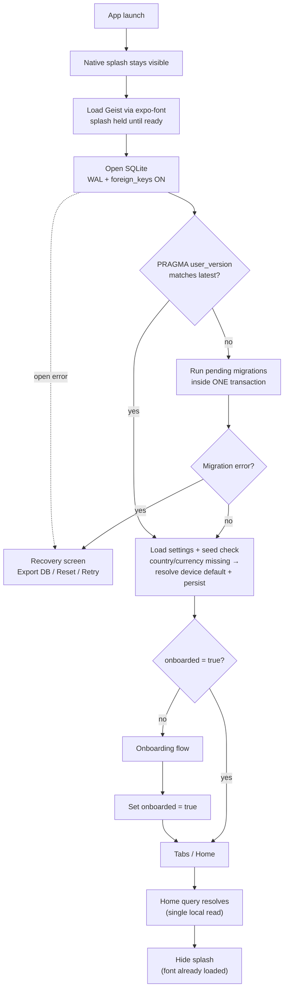

Rules:
- Splash is hidden **after** the first home query resolves, not on a timer, so users never see a
  blank flash.
- Launch never routes to `add`. Home is the only entry point, and no keyboard is mounted; the add
  flow below always begins with a deliberate action (ADR-010).
- A migration failure must never wipe data silently; recovery offers export first.
- No network call is on this path, ever.

---

## 2. Onboarding

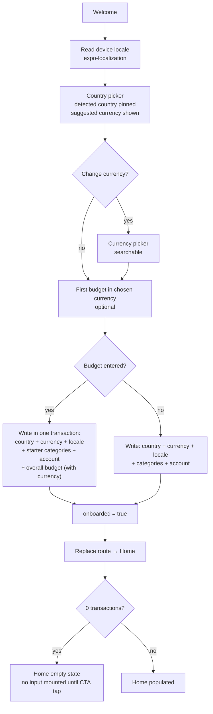

Edge cases:
- App killed mid-flow → resume at the first unfinished step (no partial writes; write only at the
  end, or one row per step with a resume marker).
- Skip on step 1 → device country/currency + starter categories, budget skipped, Home empty state.
- Country picked but currency overridden → both persist independently; a later country change
  suggests a currency but never overwrites an explicit choice without confirmation.
- User changes currency later in Settings → existing amounts are **not** converted; the app asks
  for confirmation and explains that history keeps its original currency (flow 10).

---

## 3. Add transaction

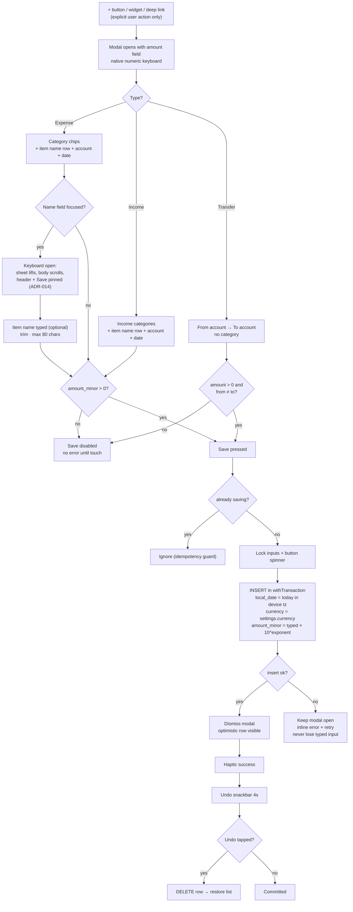

Notes:
- Category is **not** required to save; it falls back to "Uncategorized" and can be fixed later.
- Item name is optional too. Empty stays `NULL` — never write `''`, or the fallback chain
  (`item_name → place → category`) and the "named entries" metric both break.
- `local_date`, `currency` and `amount_minor` are computed once at save and never recomputed.
- There is only one input surface: amount and name both use the OS keyboard; no second keypad is mounted.
- Deep link `expensetracker://add?amount=12.50` prefills the amount only.

---

## 4. Transaction lifecycle

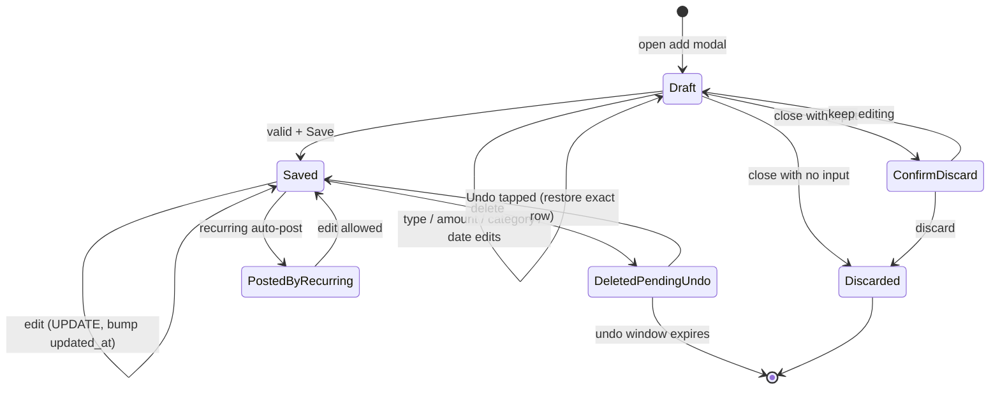

Invariants:
- `DeletedPendingUndo` is UI-only — the row is actually deleted; undo re-inserts the same id.
- Editing never changes `id` or `created_at`; only `updated_at`.
- Transfers can never have a category; expenses/incomes always keep their `category_id` unless
  the category is deleted (then `SET NULL` → "Uncategorized").

---

## 5. Safe-to-spend

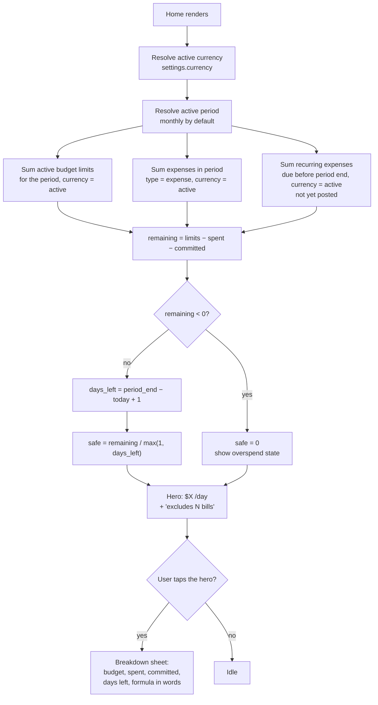

Transparency rules:
- Every input to the number is visible in the sheet — no hidden constants.
- If no overall budget exists, show `Set a budget to see this` rather than a misleading average.
- Irregular income is not part of the formula in v1 (documented limitation, not a silent guess).
- Rows in another currency are excluded and disclosed (count + a link to the filtered list); they
  are never converted, guessed at, or folded into the number.

---

## 6. Recurring posting

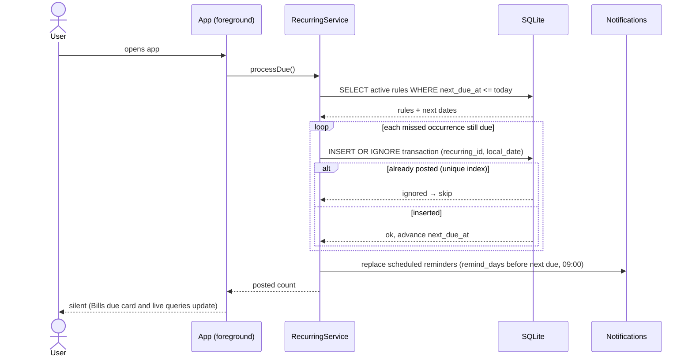

Details:
- Occurrences are computed from `start_date` + `interval_count`, never from the last posted date.
- Unique idempotency is a database guarantee: partial unique index on
  `(recurring_id, local_date)` where `recurring_id IS NOT NULL` (migration 003).

Edge cases:
- Missed months while the app was closed → post each missed occurrence individually, not a lump.
- 31st-of-month rule in February → clamp to the last day of that month, then resume the 31st.
- A yearly Feb 29 rule clamps to Feb 28 in non-leap years and resumes Feb 29 when it exists.
- Turning off a rule stops future posting but keeps already-posted transactions; an end date
  finishes a rule without deleting its history.
- Notifications are an enhancement; a "Bills due" card on Home exists as the primary reminder
  and is also the manual Post control for rules with auto-post off.

---

## 7. Search and filter

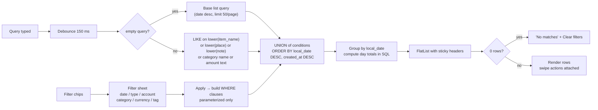

Hard requirement: **all** SQL values are bound parameters; search text never concatenated.

Currency rule: results may span currencies (history is history), but day totals are computed per
currency and the header shows the active-currency total only.

---

## 8. Export, backup, restore

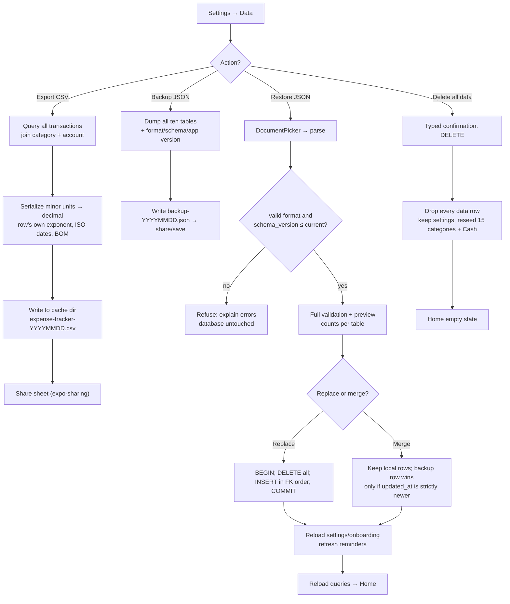

Guarantees:
- Export includes transfers and income, with a `type` column so totals are reproducible.
- A restore validates **before** touching the database; a failed parse leaves data untouched.
- Replace is transactional and follows foreign-key insert order; merge never deletes a local row.
- Settings and the onboarding flag travel in the backup; the app reloads both after a restore.
- Never offer "delete all" as a swipeable row — typed confirmation only. Reset keeps settings and
  recreates the starter library in the active currency.

---

## 9. Module dependencies (build-time)

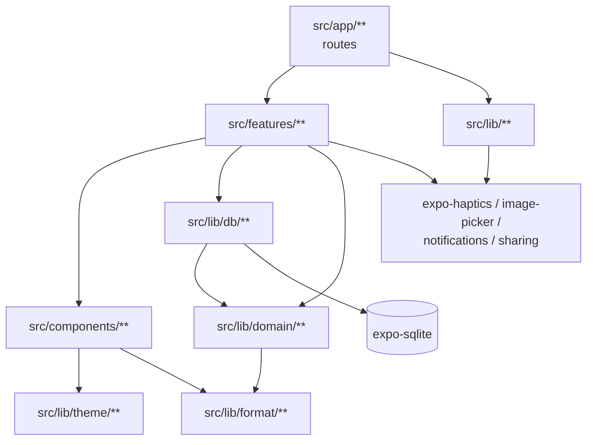

Forbidden edges (would be caught in review):
- `lib/domain` importing React, `expo-*`, or `lib/db`.
- `components` importing `features` or repositories.
- `app/**` containing SQL or business math.

---

## 10. First-week user journey

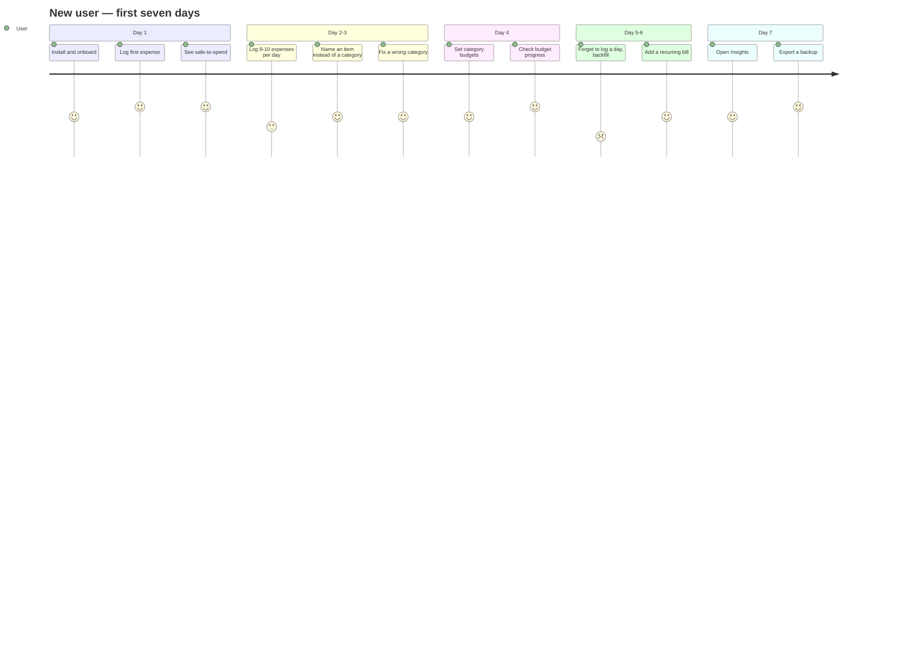

Pain points this reveals (design targets):
- Backfilling several days must be fast → date picker presets + duplicate action.
- A forgotten day must never make the home number look falsely healthy → "excludes N bills"
  and a "no entries today" nudge, not a silent average.
- Naming must not cost more than it gives → recent-name chips, optional field, and the list
  visibly rewarding a named entry (the row reads "Chicken shawarma", not "Food & Drink").

---

## 11. Change currency

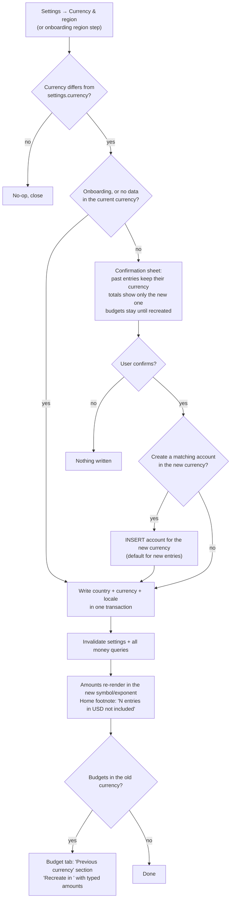

Guarantees:
- No stored amount is ever rewritten by this flow — `transactions.currency`, `budgets.currency`,
  `accounts.currency` and `recurring_rules.currency` keep their snapshots.
- No conversion and no exchange rate is ever applied or displayed.
- The confirmation is required once per change; there is no silent switch path. Onboarding writes
  directly because no money exists yet.
- Changing only the country (same currency) writes `settings.country` with no confirmation —
  flags and names are presentation, money is not.
